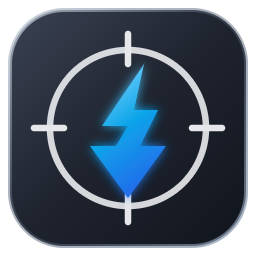
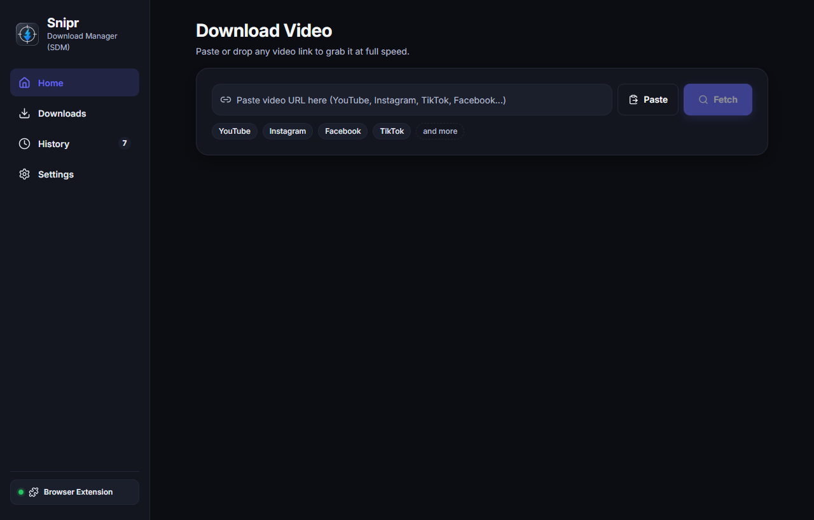
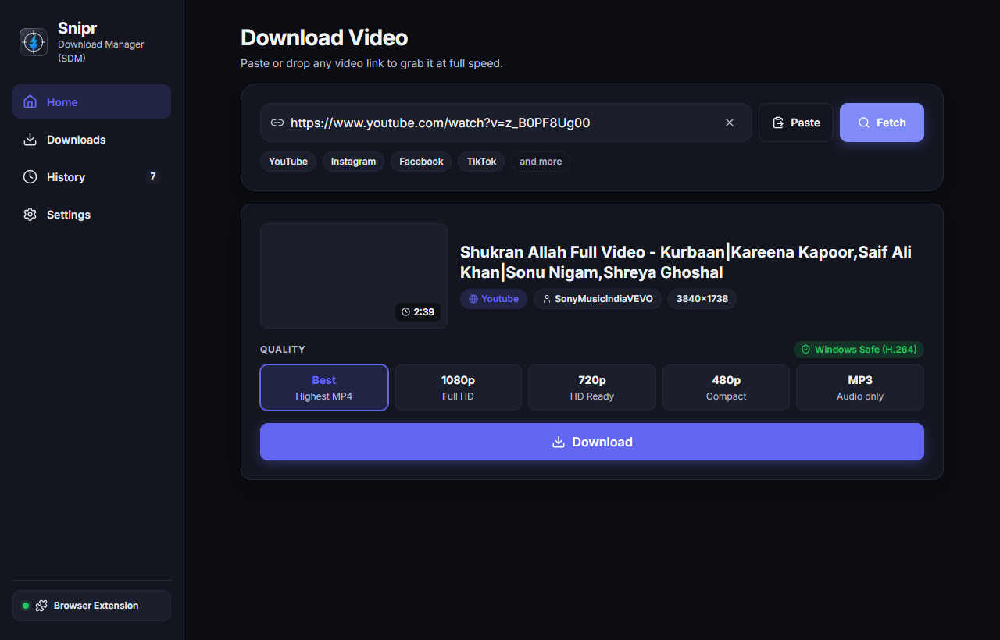
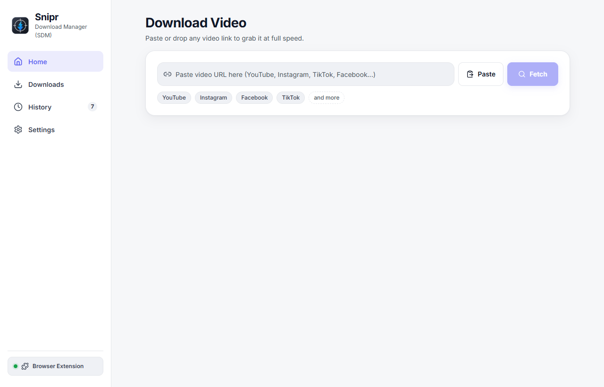
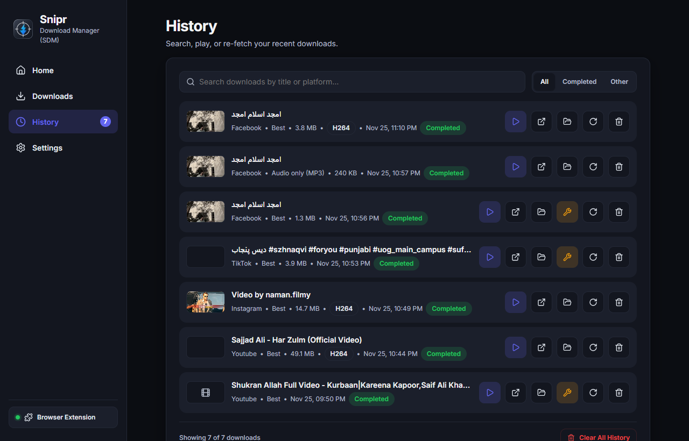
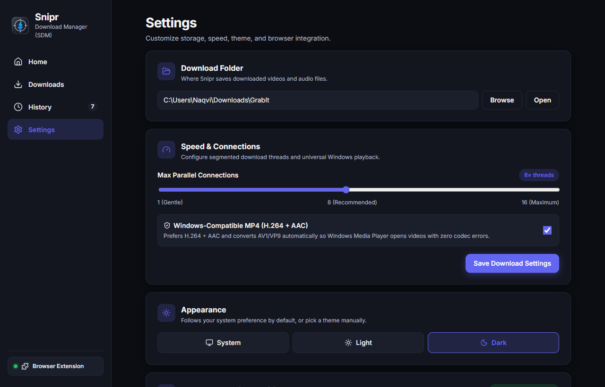
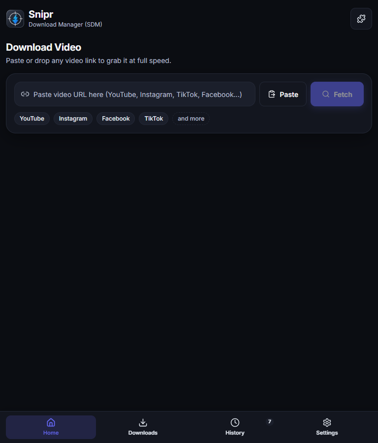
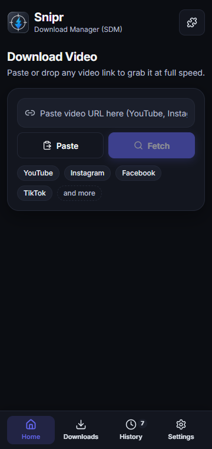

<p align="center">
  
</p>

<h1 align="center">Snipr Download Manager (SDM)</h1>

<p align="center">
  <strong>Precision. Speed. Control.</strong><br />
  A fast, open-source Windows download manager powered by <strong>yt-dlp</strong>, <strong>aria2c</strong>, and <strong>FFmpeg</strong> — paired with an IDM-style Manifest V3 browser extension.
</p>

<p align="center">
  
  
  
  
</p>

---

## Screenshots

<p align="center">
  
</p>

<details>
<summary>More screenshots (Video Preview, Light Theme, History, Settings, Tablet 768px &amp; Mobile 360px)</summary>
<br />

| Video Preview (Dark) | Desktop (Light) |
| :---: | :---: |
|  |  |

| History | Settings |
| :---: | :---: |
|  |  |

| Tablet (768px) | Mobile (360px) |
| :---: | :---: |
|  |  |

</details>

---

## Features

- **Fast Multi-Connection Downloads**: Uses `aria2c` (`-x16 -s16 -k1M`) plus fragmented `-N` concurrency for IDM-like download speeds.
- **Pause, Resume & Queue**: Keeps partial files (`--continue`) so interrupted or paused downloads resume cleanly, with an automatic queue for multiple links.
- **Playlists & Link Handling**: Fetches individual video links cleanly even from playlist URLs (`--no-playlist` single-item extraction to avoid accidental mass downloads), with support for 1,000+ non-DRM websites and direct media streams.
- **Windows-Safe Video Output**: Prefers native **H.264 + AAC MP4** and automatically converts AV1/VP9/Opus streams with `ffmpeg` when enabled so Windows Media Player opens files without extra Store codecs.
- **Built-In Media Player**: Plays completed local videos and MP3 audio directly inside Snipr over HTTP `206` Range requests using short-lived random `/stream/<id>?t=<token>` URLs.
- **IDM-Style `"Download by Snipr"` Browser Extension**: Manifest V3 extension for Chrome, Edge, and Brave that displays a floating **"Download by Snipr"** button on web video players, right-click context menus, and a passive stream detector.
- **Responsive Design System**: Offline `@fontsource/inter` typography, `lucide-react` icons, Light/Dark/System themes, desktop sidebar (`>=900px`), and mobile bottom navigation (`<900px`).

---

## Installation (Windows)

1. Download **`Snipr-Setup-1.0.0.exe`** from the [GitHub Releases](https://github.com/syedzargham-afk/snipr/releases) page.
2. Run the installer (if Windows SmartScreen prompts, see the FAQ below).
3. Launch **Snipr Download Manager** — on first launch, it automatically downloads `yt-dlp.exe`, `ffmpeg.exe`, and `aria2c.exe` into `%APPDATA%\snipr-download-manager\bin`.

---

## Browser Extension Install (`chrome://extensions`)

1. Download and unzip `snipr-extension-<version>.zip` from Releases (or click **Browser Extension → Open Extension Folder** inside Snipr to use the bundled `extension/` folder).
2. Open **`chrome://extensions`** (or **`edge://extensions`**) in your browser.
3. Enable **Developer mode** in the top-right corner.
4. Click **Load unpacked** and select the `extension` folder.
5. In Snipr desktop, open **Settings → Browser Extension & Pairing Token**, copy the **Bridge Pairing Token**, click the Snipr extension icon in your browser toolbar, paste the token, and click **Save**.

---

## Build From Source

### Prerequisites
- [Node.js](https://nodejs.org/) LTS (v20+ recommended)
- Windows 10/11 (x64)

### Commands

```bash
git clone https://github.com/syedzargham-afk/snipr.git
cd snipr

# 1. Install dependencies
npm install

# 2. Download yt-dlp.exe, ffmpeg.exe, and aria2c.exe into /bin (gitignored)
npm run setup

# 3. Start Vite + Electron in development mode
npm run dev

# 4. Build production renderer + Windows NSIS installer in /release
npm run build
```

---

## FAQ

**Why does Windows SmartScreen show "Windows protected your PC"?**
Snipr Download Manager is an independent, open-source project and its `.exe` installer is not signed with a commercial Authenticode code-signing certificate. Click **More info → Run anyway** after verifying the file's SHA-256 checksum against `SHA256SUMS.txt` on the Releases page.

**Why are `yt-dlp.exe`, `ffmpeg.exe`, and `aria2c.exe` downloaded on first run instead of bundled?**
Keeping third-party binaries out of the Git repository and `app.asar` keeps the source code and installer clean, respects upstream licenses (see [THIRD_PARTY_NOTICES.md](THIRD_PARTY_NOTICES.md)), and ensures `yt-dlp` can stay up to date automatically.

**Why does the browser extension ask for `webRequest`, `activeTab`, `contextMenus`, `storage`, and `http://*/*` / `https://*/*` permissions?**
- `activeTab`: Reads the active tab's URL and title only when you open the extension popup or click a context menu item.
- `contextMenus`: Adds the **"Download by Snipr"** right-click menu options.
- `storage`: Saves your pairing token locally in `chrome.storage.local`.
- `webRequest` + `http://*/*` / `https://*/*`: Required by Chrome Manifest V3 to passively inspect `Content-Type` / `Content-Length` media headers on the current tab (listing `.mp4` / `.m3u8` / `.mp3` streams) and inject the floating **"Download by Snipr"** bar on `<video>` players.
- `http://127.0.0.1:48921/*`: Connects exclusively to Snipr's local loopback bridge with `X-Snipr-Token`. **Zero data is sent anywhere outside `127.0.0.1`.**

---

## Disclaimer

Snipr Download Manager (SDM) is intended strictly for **personal use** and for downloading **content you own or have explicit permission to download**. Users are solely responsible for complying with each platform's Terms of Service and applicable copyright laws. DRM-protected streaming services are not supported.

Snipr Download Manager is an independent open-source project and is **not affiliated with, endorsed by, or connected to YouTube, Instagram, Facebook, TikTok, or any other platform**.

---

## License & Notices

- Code License: [MIT License](LICENSE) — Copyright (c) 2026 Syed Zargham Haider
- Third-Party Binaries: [THIRD_PARTY_NOTICES.md](THIRD_PARTY_NOTICES.md)
- Security Policy: [SECURITY.md](SECURITY.md)
- Code of Conduct: [CODE_OF_CONDUCT.md](CODE_OF_CONDUCT.md)
